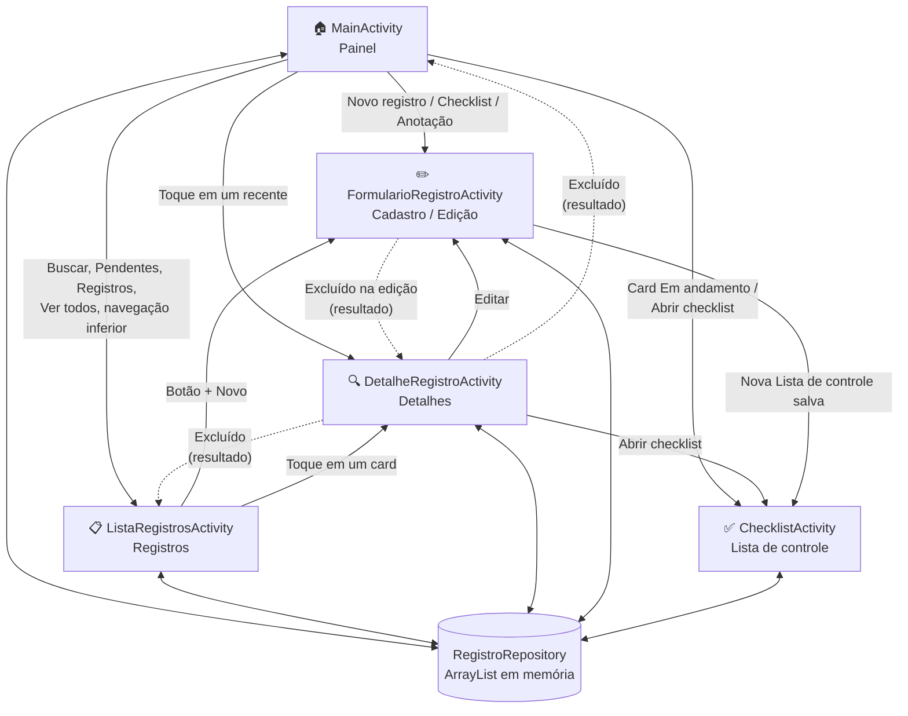

# Fluxo do aplicativo

[← Voltar ao README](../README.md) · [← Instalação](INSTALACAO.md)

Este documento explica como o usuário navega pelo *Registro de Produção*, o que cada tela faz e
como as telas trocam informações entre si (Intents, resultados e ciclo de vida).

---

## 1. Visão geral

O app tem **5 telas (Activities)**. Todas leem e gravam no mesmo repositório em memória
(`RegistroRepository`, um *Singleton* com um `ArrayList<Registro>`):



Setas contínuas = navegação com **Intent explícita**. Setas tracejadas = **resultado devolvido** para
a tela anterior (`registerForActivityResult`).

A seta **← (voltar)** segue a hierarquia definida no `AndroidManifest.xml` por `parentActivityName`:
Formulário, Lista e Checklist voltam para o Painel; Detalhes volta para a Lista.

---

## 2. Modelo de dados

Cada item manipulado pelo app é um `Registro`:

| Campo | Tipo | Regra |
|---|---|---|
| `id` | `int` | Gerado automaticamente (sequencial) |
| `titulo` | `String` | **Obrigatório**, mínimo de 3 caracteres |
| `setor` | `String` | Opcional (ex.: "Linha 2 - Envase") |
| `descricao` | `String` | Opcional |
| `categoria` | `Categoria` | `REGISTRO`, `LISTA_CONTROLE` ou `ANOTACAO` (padrão: Registro) |
| `prioridade` | `Prioridade` | `BAIXA`, `MEDIA` ou `ALTA` (padrão: Média) |
| `concluido` | `boolean` | Pendente (`false`) ou Concluído (`true`) |
| `dataCriacao` / `dataAtualizacao` | `long` | Preenchidas automaticamente pelo repositório |
| `itens` | `List<ItemChecklist>` | Só em Listas de controle: as perguntas do checklist |

Cada `ItemChecklist` tem **pergunta**, **resposta** (`SIM`, `NAO`, `NA` ou `null` = não respondido)
e **observação** (a ação corretiva, obrigatória quando a resposta é "Não").

Operações do repositório:

| Operação | Método | Observação |
|---|---|---|
| **C**reate | `adicionar(registro)` | Gera id e datas; o novo item vai para o topo da lista |
| **R**ead | `listarTodos()`, `buscarPorId(id)`, `filtrarPor(texto, filtro)`, `listarRecentes(n)`, `buscarChecklistEmAndamento()` | Sempre devolve **cópias** (inclusive dos itens), para que as telas não alterem os dados sem passar pelo repositório |
| **U**pdate | `atualizar(registro)` | Mantém a data de criação e renova a data de atualização. Também grava as respostas do checklist |
| **D**elete | `remover(id)` | Guarda o item removido para permitir **Desfazer** |
| Desfazer | `desfazerUltimaRemocao()` | Restaura o último item excluído na mesma posição |
| Contadores | `contar(filtro)`, `contarPendentes()`, `contarPrioridadeAltaPendentes()` | Usados no painel e nas pílulas de filtro |

Os filtros rápidos da lista ficam no enum `FiltroLista`: **Todos**, **Pendentes** (não concluídos),
**Alta** (prioridade alta) e **Checklists** (Listas de controle).

Na primeira abertura, `carregarExemplosSeNecessario()` insere **5 registros de exemplo**, incluindo
um checklist concluído e um checklist em andamento (2 de 4 itens respondidos).

---

## 3. Telas

### 3.1 🏠 Painel — `MainActivity`

Layouts: `activity_main.xml` + `item_recente.xml` + menu `menu_navegacao.xml`

- **Cabeçalho vermelho** com o ícone do app, botões **Buscar** (abre a lista) e **Ajuda** (diálogo
  curto), a saudação "Olá, operador" e o selo "● Offline · dados salvos neste aparelho".
- **Pendentes do turno ›**: número de registros pendentes e "X de alta prioridade · Y no total".
  Tocar abre a lista já filtrada em **Pendentes**.
- **Ações rápidas**: *Novo registro*, *Checklist* e *Anotação* abrem o formulário com a categoria
  já escolhida; *Registros* abre a lista.
- **Card preto "Em andamento"**: a Lista de controle pendente mais recente, com barra de progresso e
  "N de M itens · Continuar →", que abre o checklist. Some quando não há checklist pendente.
- **Card "Comece o turno pela conferência de EPIs"**: *Abrir checklist* continua o checklist em
  andamento ou, se não houver, abre o formulário de uma nova Lista de controle.
- **Recentes**: os 2 registros mais novos ("Categoria · Setor · hora" e prioridade). Tocar abre os
  Detalhes; *Ver todos* abre a lista.
- **Navegação inferior**: Início (ativo), Registros, Checklists (lista filtrada) e Ajustes
  (Toast "Em breve").
- **Ciclo de vida:** tudo é recalculado em `onResume()`, então os números ficam corretos sempre que
  o usuário volta ao painel.

### 3.2 📋 Registros — `ListaRegistrosActivity`

Layouts: `activity_lista_registros.xml` + `item_registro.xml` (cada card da `RecyclerView`)

- **Busca instantânea**: filtra enquanto o usuário digita, procurando no título, setor e descrição
  (sem diferenciar maiúsculas e minúsculas).
- **Filtros em pílulas com contador**: "Todos · N", "Pendentes · N", "Alta · N" e "Checklists".
  A pílula selecionada fica preta.
- Rótulo de seção (**HOJE** quando todos os itens são do dia) e contador de resultados.
- Cada card mostra o ícone e o nome da categoria, o título, a pílula de prioridade, "Setor · hora" e
  o status (Pendente em vermelho escuro com relógio; Concluído em preto com check).
- Ações:
  - **Toque no card** → abre os Detalhes.
  - **Deslizar o card** para a esquerda ou direita → exclui na hora e mostra um Snackbar com **Desfazer**.
  - **Botão "+ Novo"** → abre o Formulário (já como Lista de controle quando o filtro é "Checklists").
    O botão se recolhe ao rolar a lista para baixo e volta a expandir ao rolar para cima.
- **Ciclo de vida:** a lista é recarregada em `onResume()`; o filtro e o texto da busca são mantidos
  ao girar a tela.

### 3.3 ✅ Checklist — `ChecklistActivity`

Layouts: `activity_checklist.xml` + `item_pergunta_checklist.xml` (um card por pergunta)

- **Cabeçalho vermelho**: voltar, setor, "LISTA DE CONTROLE", título, "N de M respondidos", percentual
  e barra de progresso.
- Cada pergunta tem número, texto e três botões grandes: **Sim** (fica preto), **Não** (fica
  vermelho) e **N/A** (fica cinza). Tocar de novo na resposta marcada desfaz a escolha.
- Ao responder **Não**, aparece o bloco **"Ação corretiva necessária"** com um campo de texto.
- **Rodapé fixo**:
  - **Salvar rascunho** → grava as respostas (UPDATE) sem concluir o registro.
  - **Finalizar** → exige a ação corretiva de todos os itens "Não"; se ainda houver itens sem
    resposta, pede confirmação; então grava as respostas e marca o registro como **concluído**.
- **Voltar** com respostas não salvas → diálogo "Descartar alterações?".
- **Ciclo de vida:** as respostas e observações são salvas em `onSaveInstanceState` e restauradas ao
  girar a tela.
- Só abre registros da categoria Lista de controle; outro tipo mostra
  "Este registro não é uma lista de controle" e fecha.

### 3.4 ✏️ Cadastro / Edição — `FormularioRegistroActivity`

Layout: `activity_formulario_registro.xml` + menu `menu_formulario.xml`

É a tela que concentra o **CRUD completo**, como pede o enunciado. Ela funciona em dois modos,
definidos pelo Intent que a abriu:

| Modo | Como é aberta | Título | Extras |
|---|---|---|---|
| **Cadastro** (Create) | `criarIntentNovo(contexto, categoria)` | "O que você quer registrar?" | Categoria inicial (opcional) |
| **Edição** (Read + Update + Delete) | `criarIntentEdicao(contexto, id)` | "Editar registro" | Id do registro + lixeira na Toolbar |

Campos: categoria (3 blocos — o selecionado fica com borda vermelha), título, setor, **itens da
lista de controle** (só para Lista de controle, um por linha), prioridade (controle segmentado —
o selecionado fica vermelho), descrição e o interruptor "Já foi resolvido".

Comportamentos:

- **Validação:** se o título estiver vazio ou tiver menos de 3 caracteres, o campo fica destacado
  com a mensagem de erro e um Toast pede para verificar os campos.
- **Itens do checklist:** com o campo vazio, são usados os **5 itens padrão de segurança** (EPIs,
  extintores, saídas de emergência, botões de parada e proteções das prensas). Na edição, itens que
  continuam iguais mantêm as respostas já dadas.
- **Salvar registro:** grava no repositório, mostra o Toast de sucesso e fecha a tela. Uma **nova
  Lista de controle pendente** abre direto no Checklist para ser respondida.
- **Excluir (só na edição):** lixeira na Toolbar → diálogo de confirmação → remove o registro e
  devolve o resultado para a tela anterior.
- **X / voltar:** se houver alterações não salvas, aparece o diálogo "Descartar alterações?"
  (via `OnBackPressedCallback`). Sem alterações, a tela apenas fecha.
- **Rotação de tela:** os textos são restaurados pelo Android; categoria e prioridade são salvas
  em `onSaveInstanceState`.

### 3.5 🔍 Detalhes — `DetalheRegistroActivity`

Layout: `activity_detalhe_registro.xml`

- Cards brancos com a categoria, o título, as pílulas de prioridade e status, setor, data de criação
  e — se já foi editado — a data da última atualização, além da descrição.
- **Lista de controle:** card extra com "N de M respondidos", barra de progresso e o botão
  **Abrir checklist**.
- Ações:
  - **Marcar como concluído / Reabrir** → alterna o status na hora (UPDATE) e mostra um Snackbar.
  - **Editar** → abre o Formulário em modo de edição.
  - **Excluir** → pede confirmação, exclui, fecha a tela e avisa a tela anterior (Lista ou Painel),
    que mostra o Snackbar com **Desfazer**.
- **Ciclo de vida:** os dados são recarregados em `onResume()`, então as alterações feitas no
  Formulário ou no Checklist aparecem ao voltar.

---

## 4. Fluxos de uso (CRUD)

### ➕ Cadastrar

```
Painel ──(Novo registro / Checklist / Anotação)──► Formulário (cadastro, categoria pré-selecionada)
                              │ preenche os campos → Salvar registro
                              ├─ inválido → erro no campo + Toast "Verifique os campos destacados"
                              └─ válido   → Toast "Registro cadastrado com sucesso!"
                                            ├─ Lista de controle pendente → abre o Checklist
                                            └─ demais → volta à tela anterior (onResume atualiza)
```

### 👁️ Consultar

```
Painel ──(Buscar / Pendentes / Registros / Ver todos)──► Lista ──(busca, pílulas)──► resultados
                                                           └─(toque)──► Detalhes
```

### ✅ Responder um checklist

```
Painel ──(Em andamento / Abrir checklist)──┐
Detalhes ──(Abrir checklist)───────────────┼──► Checklist ──(Sim / Não / N/A)──►
Formulário ──(nova Lista de controle)──────┘
     ├─ Salvar rascunho → Toast "Rascunho salvo" (continua pendente)
     └─ Finalizar → [ação corretiva nos "Não"] → [confirma itens sem resposta]
                  → Toast "Checklist finalizado e marcado como concluído"
```

### ✏️ Editar

```
Lista ──► Detalhes ──(Editar)──► Formulário (edição) ──(Salvar registro)──►
          Toast "Registro atualizado com sucesso!" ──► Detalhes (onResume mostra os novos dados)
```

Atalho: em Detalhes, **Marcar como concluído / Reabrir** altera o status sem abrir o formulário.

### 🗑️ Excluir (3 caminhos, sempre com Desfazer)

```
1. Lista ──(deslizar card)──────────────────────────────────────────► Snackbar + Desfazer
2. Lista/Painel ──► Detalhes ──(Excluir → confirmar)──► volta ──────► Snackbar + Desfazer
3. Lista ──► Detalhes ──► Formulário ──(lixeira → confirmar)──► Detalhes repassa o resultado
                                                    e fecha ──► Lista ──► Snackbar + Desfazer
```

Tocar em **Desfazer** devolve o registro à mesma posição e mostra o Toast "Registro restaurado".

---

## 5. Comunicação entre telas

### Intents explícitas e extras

Cada Activity oferece métodos estáticos de fábrica que montam o próprio Intent, o que evita
repetir chaves e classes pelo código:

| Método | Abre | Extra enviado |
|---|---|---|
| `ListaRegistrosActivity.criarIntent(ctx, filtro)` | Lista | `EXTRA_FILTRO` (Todos, Pendentes, Alta ou Checklists) |
| `FormularioRegistroActivity.criarIntentNovo(ctx, categoria)` | Formulário (cadastro) | `EXTRA_CATEGORIA` (opcional) |
| `FormularioRegistroActivity.criarIntentEdicao(ctx, id)` | Formulário (edição) | `EXTRA_REGISTRO_ID` |
| `DetalheRegistroActivity.criarIntent(ctx, id)` | Detalhes | `EXTRA_REGISTRO_ID` |
| `ChecklistActivity.criarIntent(ctx, id)` | Checklist | `EXTRA_REGISTRO_ID` |

As chaves ficam em `util/Constantes.java`. Somente o **id** do registro trafega entre as telas; cada
tela busca os dados atualizados no repositório.

### Resultados entre telas

A exclusão feita em Detalhes ou no Formulário precisa ser avisada à tela de origem, para exibir o
Snackbar com Desfazer. Isso é feito com `registerForActivityResult` e o código
`RESULTADO_REGISTRO_EXCLUIDO`:

```
Formulário ──setResult(EXCLUIDO, título)──► Detalhes ──repassa o resultado e fecha──► Lista ou Painel ──► Snackbar
```

### Ciclo de vida

| Método | Uso no app |
|---|---|
| `onCreate` | Infla o layout, liga os componentes e lê os extras do Intent |
| `onResume` | Painel, Lista e Detalhes recarregam os dados do repositório |
| `onSaveInstanceState` | Formulário salva categoria e prioridade; Checklist salva respostas e observações |
| `savedInstanceState` (em `onCreate`) | Na rotação, os valores são restaurados; os valores iniciais só são preenchidos quando `savedInstanceState == null` |
| Todos (`onCreate` … `onDestroy`) | Registrados no Logcat pela `BaseActivity`, com a tag `CicloDeVida` |

---

## 6. Mensagens ao usuário

| Mensagem | Tipo | Quando aparece |
|---|---|---|
| "Registro cadastrado com sucesso!" | Toast | Ao cadastrar |
| "Registro atualizado com sucesso!" | Toast | Ao salvar uma edição |
| "Registro "X" excluído" + **Desfazer** | Snackbar | Ao excluir (Lista, Detalhes ou Formulário) |
| "Registro restaurado" | Toast | Ao tocar em Desfazer |
| "Registro marcado como concluído" / "Registro reaberto como pendente" | Snackbar | Ao alterar o status em Detalhes |
| "Verifique os campos destacados" + erro no campo | Toast + erro no `TextInputLayout` | Título vazio ou com menos de 3 caracteres |
| "Rascunho salvo" | Toast | Ao salvar o checklist sem finalizar |
| "Checklist finalizado e marcado como concluído" | Toast | Ao finalizar o checklist |
| "Preencha a ação corretiva dos itens marcados como "Não"" + erro no campo | Toast + erro no `TextInputLayout` | Ao finalizar com item "Não" sem ação corretiva |
| "Alterações descartadas" | Toast | Ao sair do formulário ou do checklist sem salvar |
| "Registro não encontrado" | Toast | Id inexistente (ex.: registro já excluído) |
| "Em breve" | Toast | Item "Ajustes" da navegação inferior |
| "Excluir registro?" | Diálogo | Antes de excluir em Detalhes ou no Formulário |
| "Descartar alterações?" | Diálogo | Ao voltar do Formulário ou do Checklist com alterações não salvas |
| "Finalizar checklist?" | Diálogo | Ao finalizar com itens ainda sem resposta |
| "Como usar" | Diálogo | Botão de ajuda do painel |

---

## 7. Acessibilidade e uso em ambiente industrial

- Botões principais de 60 dp, respostas do checklist de 52 dp e áreas de toque de pelo menos 48 dp,
  fáceis de tocar com luvas.
- Alto contraste (vermelho, branco e preto) e textos grandes; prioridade e status identificados por
  **forma, texto e cor** (não só por cor).
- Descrições de conteúdo (`contentDescription`) nos botões de ícone e no interruptor, para leitores
  de tela.
- `minSdk 21`: roda em equipamentos robustos com versões antigas do Android. As fontes vão dentro
  do APK e funcionam desde o Android 5.0.

---

## 8. Roteiro para o vídeo de evidência (até 30 s)

No Android Studio, com o emulador aberto: painel **Running Devices** → **Record Screen** → ao
terminar, **Stop** e salve o `.mp4`. Para prints, use **Take Screenshot** no mesmo painel.

| Tempo | Ação |
|---|---|
| 0–4 s | Painel: mostrar os pendentes do turno, as ações rápidas e o card "Em andamento" |
| 4–10 s | Tocar no card "Em andamento" → responder um item com **Não** (aparece a ação corretiva) → **Salvar rascunho** |
| 10–15 s | **Novo registro** → título e setor → prioridade **Alta** → **Salvar registro** (Toast) |
| 15–20 s | **Registros** → digitar na busca e tocar na pílula **Pendentes** |
| 20–25 s | Tocar em um card → Detalhes → **Marcar como concluído** (Snackbar) |
| 25–29 s | Voltar à lista, deslizar um card para excluir → tocar em **Desfazer** |
