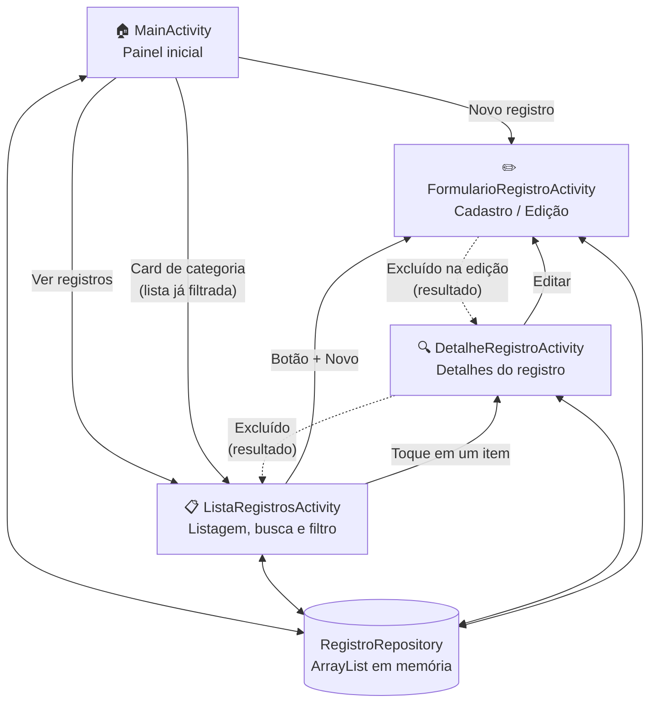

# Fluxo do aplicativo

[← Voltar ao README](../README.md) · [← Instalação](INSTALACAO.md)

Este documento explica como o usuário navega pelo *Registro de Produção*, o que cada tela faz e
como as telas trocam informações entre si (Intents, resultados e ciclo de vida).

---

## 1. Visão geral

O app tem **4 telas (Activities)**. Todas leem e gravam no mesmo repositório em memória
(`RegistroRepository`, um *Singleton* com um `ArrayList<Registro>`):



Setas contínuas = navegação com **Intent explícita**. Setas tracejadas = **resultado devolvido** para
a tela anterior (`registerForActivityResult`).

A seta **← (voltar)** da Toolbar segue a hierarquia definida no `AndroidManifest.xml` por
`parentActivityName`: Formulário e Lista voltam para o Painel; Detalhes volta para a Lista.

---

## 2. Modelo de dados

Cada item manipulado pelo app é um `Registro`:

| Campo | Tipo | Regra |
|---|---|---|
| `id` | `int` | Gerado automaticamente (sequencial) |
| `titulo` | `String` | **Obrigatório**, mínimo de 3 caracteres |
| `setor` | `String` | Opcional (ex.: "Linha 2 - Envase") |
| `descricao` | `String` | Opcional |
| `categoria` | `Categoria` | `REGISTRO`, `LISTA_CONTROLE` ou `ANOTACAO` (padrão: Registro) |
| `prioridade` | `Prioridade` | `BAIXA`, `MEDIA` ou `ALTA` (padrão: Média) |
| `concluido` | `boolean` | Pendente (`false`) ou Concluído (`true`) |
| `dataCriacao` / `dataAtualizacao` | `long` | Preenchidas automaticamente pelo repositório |

Operações do repositório:

| Operação | Método | Observação |
|---|---|---|
| **C**reate | `adicionar(registro)` | Gera id e datas; o novo item vai para o topo da lista |
| **R**ead | `listarTodos()`, `buscarPorId(id)`, `filtrar(texto, categoria)` | Sempre devolve **cópias**, para que as telas não alterem os dados sem passar pelo repositório |
| **U**pdate | `atualizar(registro)` | Mantém a data de criação e renova a data de atualização |
| **D**elete | `remover(id)` | Guarda o item removido para permitir **Desfazer** |
| Desfazer | `desfazerUltimaRemocao()` | Restaura o último item excluído na mesma posição |

Na primeira abertura, `carregarExemplosSeNecessario()` insere **5 registros de exemplo**.

---

## 3. Telas

### 3.1 🏠 Painel inicial — `MainActivity`

Layout: `activity_main.xml` (+ `item_categoria_resumo.xml` para os cards)

- Mostra um **resumo**: total de registros, quantos estão pendentes e quantos são de prioridade alta
  e ainda pendentes.
- Mostra **3 cards de categoria** (Registros, Listas de controle, Anotações) com a quantidade de cada uma.
- Ações:
  - **Novo registro** → abre o Formulário em modo de cadastro.
  - **Ver todos os registros** → abre a Lista sem filtro.
  - **Toque em um card** → abre a Lista já filtrada por aquela categoria.
- **Ciclo de vida:** o resumo é recalculado em `onResume()`, então os números ficam corretos sempre
  que o usuário volta ao painel depois de cadastrar, editar ou excluir.

### 3.2 📋 Listagem — `ListaRegistrosActivity`

Layouts: `activity_lista_registros.xml` + `item_registro.xml` (cada linha da `RecyclerView`)

- **Busca instantânea**: filtra enquanto o usuário digita, procurando no título, setor e descrição
  (sem diferenciar maiúsculas e minúsculas).
- **Filtro por categoria** com chips: Todos, Registros, Listas, Anotações.
- **Contador** de resultados e **estado vazio** ("Nenhum registro encontrado").
- Cada item mostra ícone e cor da categoria, título, setor, data, prioridade e status.
- Ações:
  - **Toque no item** → abre os Detalhes.
  - **Deslizar o item** para a esquerda ou direita → exclui na hora e mostra um Snackbar com **Desfazer**.
  - **Botão flutuante "+ Novo"** → abre o Formulário já com a categoria do filtro selecionada.
    O botão se recolhe ao rolar a lista para baixo e volta a expandir ao rolar para cima.
- **Ciclo de vida:** a lista é recarregada em `onResume()`; o filtro e o texto da busca são mantidos
  ao girar a tela.

### 3.3 🔍 Detalhes — `DetalheRegistroActivity`

Layout: `activity_detalhe_registro.xml`

- Exibe todos os campos do registro, a data de criação e — se já foi editado — a data da última
  atualização.
- Ações:
  - **Marcar como concluído / Reabrir** → alterna o status na hora (UPDATE) e mostra um Snackbar.
  - **Editar** → abre o Formulário em modo de edição.
  - **Excluir** → pede confirmação em um diálogo, exclui, fecha a tela e avisa a Lista, que mostra o
    Snackbar com **Desfazer**.
- **Ciclo de vida:** os dados são recarregados em `onResume()`, então as alterações feitas no
  Formulário aparecem ao voltar. Se o registro não existir mais, a tela mostra
  "Registro não encontrado" e é fechada.

### 3.4 ✏️ Cadastro / Edição — `FormularioRegistroActivity`

Layout: `activity_formulario_registro.xml` + menu `menu_formulario.xml`

É a tela que concentra o **CRUD completo**, como pede o enunciado. Ela funciona em dois modos,
definidos pelo Intent que a abriu:

| Modo | Como é aberta | Título | Botão principal | Extras |
|---|---|---|---|---|
| **Cadastro** (Create) | `criarIntentNovo(contexto, categoria)` | "Novo registro" | **Cadastrar** | Categoria inicial (opcional) |
| **Edição** (Read + Update + Delete) | `criarIntentEdicao(contexto, id)` | "Editar registro" | **Salvar alterações** | Id do registro + ícone de lixeira na Toolbar |

Campos: categoria (chips), título, setor, prioridade (botões Baixa / Média / Alta), descrição e
o interruptor "Concluído".

Comportamentos:

- **Validação:** se o título estiver vazio ou tiver menos de 3 caracteres, o campo fica destacado
  com a mensagem de erro e um Toast pede para verificar os campos. O erro some quando o usuário volta
  a digitar.
- **Salvar:** grava no repositório, mostra o Toast de sucesso e fecha a tela.
- **Excluir (só na edição):** lixeira na Toolbar → diálogo de confirmação → remove o registro e
  devolve o resultado para a tela anterior.
- **Cancelar / voltar:** se houver alterações não salvas, aparece o diálogo
  "Descartar alterações?" (via `OnBackPressedCallback`). Sem alterações, a tela apenas fecha.
- **Rotação de tela:** os campos preenchidos são mantidos.

---

## 4. Fluxos de uso (CRUD)

### ➕ Cadastrar

```
Painel ──(Novo registro)──► Formulário (cadastro)
                              │ preenche os campos → Cadastrar
                              ├─ inválido → erro no campo + Toast "Verifique os campos destacados"
                              └─ válido   → Toast "Registro cadastrado com sucesso!" → volta à tela anterior
                                            (onResume atualiza o resumo/lista)
```

### 👁️ Consultar

```
Painel ──(Ver registros / card)──► Lista ──(busca, chips)──► resultados filtrados
                                     └─(toque)──► Detalhes
```

### ✏️ Editar

```
Lista ──► Detalhes ──(Editar)──► Formulário (edição) ──(Salvar alterações)──►
          Toast "Registro atualizado com sucesso!" ──► Detalhes (onResume mostra os novos dados)
```

Atalho: em Detalhes, **Marcar como concluído / Reabrir** altera o status sem abrir o formulário.

### 🗑️ Excluir (3 caminhos, sempre com Desfazer)

```
1. Lista ──(deslizar item)──────────────────────────────────────────► Snackbar + Desfazer
2. Lista ──► Detalhes ──(Excluir → confirmar)──► volta para a Lista ──► Snackbar + Desfazer
3. Lista ──► Detalhes ──► Formulário ──(lixeira → confirmar)──► Detalhes repassa o resultado
                                                    e fecha ──► Lista ──► Snackbar + Desfazer
```

Tocar em **Desfazer** devolve o registro à mesma posição e mostra o Toast "Registro restaurado".

---

## 5. Comunicação entre telas

### Intents explícitas e extras

Cada Activity oferece métodos estáticos de fábrica que montam o próprio Intent, o que evita
repetir chaves e classes pelo código:

| Método | Abre | Extra enviado |
|---|---|---|
| `ListaRegistrosActivity.criarIntent(ctx, categoria)` | Lista | `EXTRA_CATEGORIA` (opcional) |
| `FormularioRegistroActivity.criarIntentNovo(ctx, categoria)` | Formulário (cadastro) | `EXTRA_CATEGORIA` (opcional) |
| `FormularioRegistroActivity.criarIntentEdicao(ctx, id)` | Formulário (edição) | `EXTRA_REGISTRO_ID` |
| `DetalheRegistroActivity.criarIntent(ctx, id)` | Detalhes | `EXTRA_REGISTRO_ID` |

As chaves ficam em `util/Constantes.java`. Somente o **id** do registro trafega entre as telas; cada
tela busca os dados atualizados no repositório.

### Resultados entre telas

A exclusão feita em Detalhes ou no Formulário precisa ser avisada à Lista, para exibir o Snackbar
com Desfazer. Isso é feito com `registerForActivityResult` e o código `RESULTADO_REGISTRO_EXCLUIDO`:

```
Formulário ──setResult(EXCLUIDO, título)──► Detalhes ──repassa o resultado e fecha──► Lista ──► Snackbar
```

### Ciclo de vida

| Método | Uso no app |
|---|---|
| `onCreate` | Infla o layout, liga os componentes e lê os extras do Intent |
| `onResume` | Painel, Lista e Detalhes recarregam os dados do repositório |
| `savedInstanceState` (em `onCreate`) | Na rotação, o Android restaura campos, busca e filtro; o app só preenche os valores iniciais quando `savedInstanceState == null` |
| Todos (`onCreate` … `onDestroy`) | Registrados no Logcat pela `BaseActivity`, com a tag `CicloDeVida` |

---

## 6. Mensagens ao usuário

| Mensagem | Tipo | Quando aparece |
|---|---|---|
| "Registro cadastrado com sucesso!" | Toast | Ao cadastrar |
| "Registro atualizado com sucesso!" | Toast | Ao salvar uma edição |
| "Registro "X" excluído" + **Desfazer** | Snackbar | Ao excluir (Lista, Detalhes ou Formulário) |
| "Registro restaurado" | Toast | Ao tocar em Desfazer |
| "Registro marcado como concluído" / "Registro reaberto como pendente" | Snackbar | Ao alterar o status em Detalhes |
| "Verifique os campos destacados" + erro no campo | Toast + erro no `TextInputLayout` | Título vazio ou com menos de 3 caracteres |
| "Alterações descartadas" | Toast | Ao sair do formulário sem salvar |
| "Registro não encontrado" | Toast | Id inexistente (ex.: registro já excluído) |
| "Excluir registro?" | Diálogo | Antes de excluir em Detalhes ou no Formulário |
| "Descartar alterações?" | Diálogo | Ao voltar do Formulário com alterações não salvas |

---

## 7. Acessibilidade e uso em ambiente industrial

- Botões grandes (56 dp), fáceis de tocar com luvas.
- Alto contraste e textos grandes; categorias e prioridades identificadas por **cor e texto**
  (não só por cor).
- Descrições de conteúdo (`contentDescription`) nos cards e ícones, para leitores de tela.
- `minSdk 21`: roda em equipamentos robustos com versões antigas do Android.

---

## 8. Roteiro para o vídeo de evidência (até 30 s)

No Android Studio, com o emulador aberto: painel **Running Devices** → **Record Screen** → ao
terminar, **Stop** e salve o `.mp4`. Para prints, use **Take Screenshot** no mesmo painel.

| Tempo | Ação |
|---|---|
| 0–4 s | Painel inicial: mostrar o resumo e as categorias |
| 4–11 s | **Novo registro** → preencher título e setor → prioridade Alta → **Cadastrar** (Toast) |
| 11–15 s | **Ver todos os registros** → digitar na busca e tocar em um chip de filtro |
| 15–20 s | Tocar em um item → Detalhes → **Marcar como concluído** (Snackbar) |
| 20–25 s | **Editar** → alterar o título → **Salvar** (Toast) |
| 25–28 s | Na Lista, deslizar um item para excluir → tocar em **Desfazer** |
